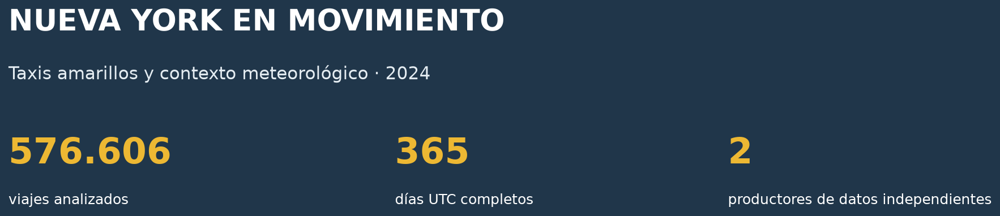
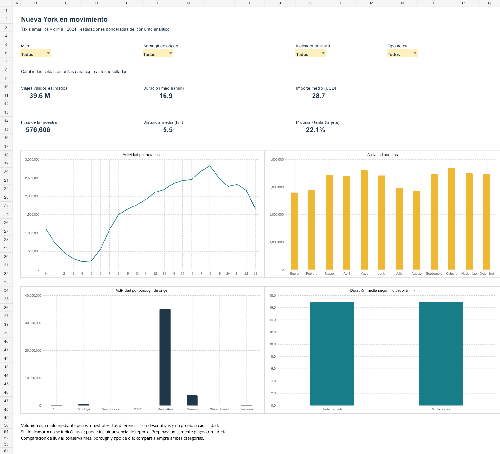

# Nueva York en movimiento
## Viajes en taxi, clima y patrones de movilidad (2024)

Repositorio público: https://github.com/KerolainK/nyc-taxi-clima-2024

Proyecto de análisis exploratorio con **Python y Pandas**, notebook ejecutado, **dashboard operativo en Excel** e informe explicativo en español.





## Pregunta y resultado principal

¿Cómo se relaciona la lluvia indicada con la actividad de los taxis amarillos, la duración y las propinas después de considerar calendario y temperatura?

El conjunto final contiene **576.606 filas y 44 columnas**, procedentes de dos productores independientes: NYC TLC y NOAA. Abarca **365 días UTC completos**, del 2 de enero al 31 de diciembre de 2024.

Los modelos diarios estiman una asociación con lluvia del **+2,58%** para volumen (IC95% -0,36% a +5,61%), **+0,90%** para duración (-0,42% a +2,24%) y **+0,070 puntos porcentuales** para propinas en tarjeta (-0,037 a +0,176). Ninguna de las tres pruebas alcanza 0,05 después de Holm. **No se demuestra ausencia de efecto ni causalidad**. La ampliación encuentra fuerte dependencia residual en el modelo principal. Un modelo dinámico estima +0,62% (IC95% -1,21% a +2,49%). Excluir cinco días influyentes produce un p nominal de 0,036: esta sensibilidad se informa como exploratoria y evita una conclusión categórica. Los intervalos del 95% son puntuales; Holm se aplica a los p-valores.

Otros resultados ponderados: duración mediana de **13,1 min**, tarifa base mediana de **14,2 USD** y propina agregada sobre tarifa en tarjeta del **22,1%**. El importe medio registrado es **28,7 USD**, sin incluir propinas en efectivo.

## Lo que cuenta el análisis

| Hallazgo | Lectura útil | Límite |
|---|---|---|
| Máximo de recogidas a las **18:00** | Identifica una franja para monitorizar actividad | No mide solicitudes no atendidas |
| **88,8%** de recogidas en Manhattan | Delimita el mercado de taxis amarillos observado | No representa toda la movilidad de NYC |
| Las diez primeras zonas concentran **37,9%** | Prioriza zonas para un seguimiento más detallado | No prueba rentabilidad ni falta de oferta |
| La asociación de lluvia depende de la especificación | Exige mirar intervalos, residuos y sensibilidad | No justifica un incremento fijo ni causal |

## Cómo entender lo que hay detrás

1. Leer [la guía de razonamiento](reports/Guia_razonamiento.md): para cada paso explica pregunta, qué se hizo, por qué y qué no permite concluir.
2. Seguir el [notebook ejecutado](notebooks/EDA_Taxis_Clima_2024.ipynb), que conecta datos con cálculos, modelos y resultados reales.
3. En Excel, abrir **Calculos** para ver fórmulas y explicaciones cercanas; **Razonamiento** desarrolla catorce decisiones y un ejemplo de ponderación.
4. Consultar **Robustez**: muestra todas las sensibilidades, no solo la que da el menor p-valor. **Patrones** contiene una matriz semanal y las zonas principales.
5. Leer la memoria para unir hallazgos, método, aplicaciones y límites.

La cadena de trazabilidad es: **registro fuente → limpieza → peso → fecha UTC → unión → agregado → fórmula → interpretación**.

### Qué aporta la versión ampliada

- Cuatro filtros y siete hojas de Excel, con explicaciones y alcance declarado.
- Matriz horaria por día de semana, ranking de zonas y perfiles normalizados.
- Ocho especificaciones de sensibilidad; diagnósticos de residuos, autocorrelación, heterocedasticidad e influencia.
- Modelo con tendencia estacional flexible y modelo condicionado al volumen anterior, tratados como análisis exploratorios.
- Guía de razonamiento compartida por Excel, notebook, memoria y preparación de la defensa.

## Abrir primero

- [Memoria explicativa ampliada](reports/Memoria_Taxis_Clima_2024_v2.pdf)
- [Dashboard de Excel](dashboard/Dashboard_Taxis_Clima_2024_v2.xlsx)
- [Notebook ejecutado](notebooks/EDA_Taxis_Clima_2024.ipynb)
- [Guion de presentación y preguntas de defensa](reports/Guion_defensa.md)
- [Guía: por qué se hizo cada paso](reports/Guia_razonamiento.md)
- [Diccionario de las 44 columnas](reports/diccionario_datos.csv)

## Fuentes: las dos están catalogadas en data.gov

| Datos | Productor independiente | Enlace del catálogo |
|---|---|---|
| Viajes de taxis amarillos de 2024 | NYC Taxi and Limousine Commission (TLC) | [2024 Yellow Taxi Trip Data](https://catalog.data.gov/dataset/2024-yellow-taxi-trip-data) |
| Observaciones meteorológicas diarias | NOAA / NCEI | [Global Surface Summary of the Day](https://catalog.data.gov/dataset/global-surface-summary-of-the-day-gsod) |

Data.gov es el catálogo. La distribución mensual se descarga desde [TLC Trip Record Data](https://www.nyc.gov/site/tlc/about/tlc-trip-record-data.page), del mismo productor. Las observaciones NOAA corresponden a LaGuardia, estación **72503014732**. La tabla de zonas TLC es un recurso auxiliar; no se cuenta como segunda fuente.

### Datos brutos incluidos

- `data/raw/taxi_2024_extracto_sin_limpiar.csv.gz`: **600.000 filas antes de limpiar**, con los 19 campos TLC originales y dos campos de trazabilidad. Es un extracto muestral reproducible, no la descarga completa de 41.169.720 filas. Conserva valores originales, incluidos errores y ausencias.
- `data/raw/noaa_lga_2024.csv` y `noaa_lga_2025.csv`: archivos NOAA originales. De 2025 solo se usa el 1 de enero para verificar la cobertura del límite temporal antes de excluir días UTC parciales.
- `data/raw/manifiesto_tlc.json`: URL, tamaño en filas, semilla y SHA-256 de cada uno de los doce archivos fuente.
- `data/raw/taxi_zone_lookup.csv`: nombres de zonas y boroughs TLC.

Los archivos mensuales completos se descargan con el script 00 y se conservan localmente en `data/raw/originales/`; esa carpeta se excluye de Git para evitar duplicar cientos de MB. El extracto bruto y el manifiesto permiten repetir la limpieza sin descargar todo de nuevo.

## Método

1. **Muestreo antes de limpiar.** 50.000 filas aleatorias sin reemplazo por mes, semilla 202400 + mes. Peso por fila = filas fuente del mes / 50.000. Así no se confunden meses con igual muestra y distinto volumen.
2. **Limpieza.** Fechas fuera del mes, duración o distancia no plausibles, tarifas no positivas, propinas negativas o ausentes y velocidades superiores a 100 mph. Se registra cada regla y se distingue incidencia de exclusión adicional. No se imputan pasajeros ni meteorología.
3. **Tiempo y unión.** America/New_York se convierte a UTC, incluyendo horario de verano. Se excluyen 120 horas ambiguas/inexistentes y 1.484 filas de días UTC parciales. La unión por fecha es muchos-a-uno: no multiplica viajes y no deja correspondencias meteorológicas ausentes.
4. **EDA.** Medias, cuantiles y porcentajes ponderados; distribuciones, patrones por hora y mes, territorio y correlaciones. Se conservan los valores extremos que superan las reglas; recortar un eje de un histograma no elimina filas.
5. **Estadística.** Una observación por día UTC (365). OLS ajustado por mes, día de semana, temperatura y nieve; duración ajustada también por distancia media. Covarianza HAC con siete retardos y corrección Holm para tres pruebas de lluvia.
6. **Sensibilidad.** Reducir la duración máxima a 120 min mantiene la estimación de volumen prácticamente igual: +2,57% frente a +2,58%.

## Dashboard operativo

Abrir `dashboard/Dashboard_Taxis_Clima_2024_v2.xlsx` y cambiar las celdas amarillas de **Mes**, **Borough de origen**, **Indicador de lluvia** y **Tipo de día**. Los seis indicadores y cuatro gráficos de Dashboard se recalculan con fórmulas de Excel. Se añade el filtro de tipo de día (Lun-vie / Fin semana), una hoja de patrones anuales y una hoja con modelos y sensibilidad.

- El volumen es una **estimación ponderada** de viajes válidos, no un conteo exacto.
- Las medias son razones de sumas ponderadas. La propina se restringe a pagos con tarjeta.
- La hoja Datos contiene 4.810 agregados que recogen todas las filas del conjunto final; no es una muestra adicional.
- Los filtros consultan la base incluida. Para añadir nuevas descargas hay que regenerar la base y reconstruir el libro.
- Se han contrastado el total y tres combinaciones de filtros con cálculos independientes en `dashboard/verificacion_excel.json`. Se comprobaron las fórmulas con el motor de generación, referencias y estructura del Excel exportado. No se afirma una prueba en una sesión nativa de Microsoft Excel.

### Las siete hojas

| Hoja | Para qué sirve | Alcance |
|---|---|---|
| Dashboard | Explorar indicadores con cuatro filtros | Selección activa |
| Patrones | Ritmo semanal, zonas y perfiles relativos | Año completo |
| Robustez | Intervalos, sensibilidades y diagnósticos | Modelos diarios del estudio |
| Calculos | Fórmulas, sumas y explicación de cada bloque | Soporte del dashboard |
| Razonamiento | Pregunta, método, motivo y límite de cada decisión | Guía metodológica |
| Datos | Agregados trazables de todas las filas finales | Base incluida |
| Metodologia | Definiciones, fuentes y uso | Referencia |

La comparación de duración por lluvia conserva mes, borough y tipo de día; ignora solo el selector de lluvia para mostrar ambas categorías. Patrones y Robustez no recalculan modelos al mover filtros.

## Reproducir en VS Code

Requiere Python 3.12 compatible. Las versiones exactas usadas están en `entorno_utilizado.json`.

```text
python -m venv .venv
```

Activar el entorno virtual y ejecutar:

```text
python -m pip install -r requirements.txt
python src/01_preparar.py
python src/02_analizar.py
python src/07_profundizar.py
python src/03_memoria.py
python src/05_notebook.py
python src/06_verificar.py
```

El notebook también se puede abrir con las extensiones Python y Jupyter de VS Code; usar un kernel que tenga las dependencias de requirements.txt. Sus diez celdas de código se entregan ejecutadas.

Para reconstruir el extracto a partir de las descargas completas:

```text
python src/00_descargar.py
```

Esta descarga requiere espacio para los doce archivos originales. Si cambia una publicación fuente, comparar su SHA-256 con el manifiesto entregado antes de esperar resultados idénticos. Los archivos `.csv.gz` y `.csv.xz` son CSV comprimidos: Pandas los lee directamente. El dataset final también se incluye en Parquet.

El generador `src/04_dashboard.mjs` requiere Node.js y `@oai/artifact-tool`, disponible en el entorno de autoría. Puede indicarse su módulo con `ARTIFACT_TOOL_MODULE`. Esta dependencia solo es necesaria para reconstruir el libro; **usar los filtros del Excel entregado no requiere Node ni Python**. Para regenerar el notebook se ejecutan realmente las celdas y se capturan sus salidas.

## Organización

```text
├── README.md
├── requirements.txt
├── entorno_utilizado.json
├── data/
│   ├── raw/          # Extracto sin limpiar, NOAA, zonas y manifiesto
│   └── processed/    # Dataset final y tablas de análisis/dashboard
├── notebooks/        # EDA ejecutado
├── src/              # Descarga, limpieza, análisis y generación
├── dashboard/        # Excel operativo, vista y verificación
└── reports/          # Memoria, figuras, calidad, modelos y defensa
```

## Límites que afectan a las conclusiones

- El indicador NOAA 0 significa **no indicado o no reportado**, no ausencia segura de lluvia. La estación LaGuardia no representa cada zona y la meteorología diaria no describe la lluvia exacta de cada viaje.
- Los totales de precipitación NOAA pueden incluir parte del día anterior. No se convierten códigos de ausencia a cero.
- La muestra estratificada requiere pesos. HAC describe incertidumbre en la serie diaria construida y no reemplaza una varianza completa de diseño de encuesta. Los resultados inferenciales son exploratorios.
- Los festivos se estudian en sensibilidades adicionales. No se incluyen todos los eventos ni la disponibilidad de taxis. Las regresiones agregadas no identifican efectos individuales o causales.
- Las propinas en efectivo no están incluidas en los registros de propinas ni en el importe total. No se analiza ingreso neto del conductor.
- TLC no publica un ID único de viaje. Se usa mes de archivo + fila fuente como clave de trazabilidad; no se inventan identificadores personales.

## Correspondencia con la entrega

Dos productores independientes; datos brutos adjuntos; dataset final con más de 50.000 filas y 20 columnas; limpieza profunda; análisis descriptivo y estadístico; visualización; dashboard operativo; memoria y README. El paquete está organizado para GitHub. **Repositorio público: https://github.com/KerolainK/nyc-taxi-clima-2024.**

## Referencias y atribución

- [TLC: publicación oficial y diccionarios](https://www.nyc.gov/site/tlc/about/tlc-trip-record-data.page).
- [NOAA: documentación GSOD](https://www.ncei.noaa.gov/data/global-summary-of-the-day/doc/readme.txt).
- [Statsmodels: covarianza robusta HAC](https://www.statsmodels.org/stable/generated/statsmodels.regression.linear_model.OLSResults.get_robustcov_results.html).

Atribución de datos: NYC TLC / NYC Open Data y NOAA / NCEI. La redistribución y el uso se rigen por las condiciones de sus productores. El proyecto no es una publicación oficial de esos organismos.


El CSV final usa compresión XZ sin pérdida y el Parquet usa Zstandard; ambos conservan las mismas 576.606 filas y 44 columnas. La ordenación por fecha facilita la compresión y no modifica los valores ni los resultados.


### Calendario auxiliar y diagnósticos

El calendario federal 2024 se transcribe de una [publicación oficial de CBP](https://content.govdelivery.com/accounts/USDHSCBP/bulletins/38366be). Es una variable auxiliar de sensibilidad por fecha UTC, no una cobertura completa de fiestas locales. [Statsmodels documenta los diagnósticos](https://www.statsmodels.org/stable/stats.html). Los p-valores de sensibilidad son exploratorios; no se utilizan para seleccionar retrospectivamente una confirmación.
